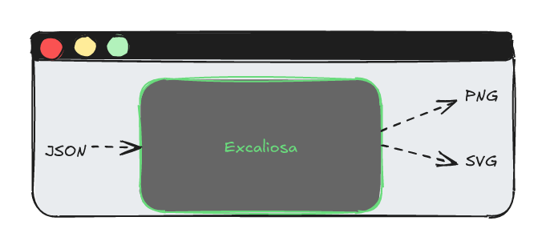

# Excaliosa

_It's ExcaliOsa not ExcalioSAR._

A Rust CLI tool that converts Excalidraw JSON diagrams to PNG or SVG format. 

The objective is not a one-to-one match with Excalidraw rendering, but just enough for it to be useful when automated. For example, I usually only use rounded rectangles and arrows.

## Installation

### From Source

```bash
git clone <repository>
cd excaliosa
cargo build --release
```

The binary will be available at `target/release/excaliosa`.

### Docker

You can use the prebuilt container image from the GitHub Container Registry:

```bash
docker run --rm \
  --user "$(id -u):$(id -g)" \
  -v "$PWD:/work" -w /work \
  ghcr.io/jguer/excaliosa:latest examples/arrows.json -o out.png
```

If you're on a SELinux enabled system, keep the volume flag relabel like `-v "$PWD:/work:z"`.

Examples:

```bash
# Convert a local JSON diagram to PNG (output next to the file)
docker run --rm -v "$PWD:/work" -w /work ghcr.io/jguer/excaliosa:latest examples/arrows.json

# Specify an explicit output path
docker run --rm -v "$PWD:/work" -w /work ghcr.io/jguer/excaliosa:latest examples/arrows.json -o out.png

# Export to SVG
docker run --rm -v "$PWD:/work" -w /work ghcr.io/jguer/excaliosa:latest examples/arrows.json -o arrows.svg
```

## Usage

### Basic Usage

Convert an Excalidraw JSON file to PNG:

```bash
excaliosa path/to/diagram.json
```

This will create a PNG file with the same name as the input (e.g., `diagram.png`).

### Custom Output Path

Specify a custom output file path:

```bash
excaliosa path/to/diagram.json -o output.png
excaliosa path/to/diagram.json --output my_diagram.png
```

To export as SVG, just use an `.svg` extension:

```bash
excaliosa path/to/diagram.json -o diagram.svg
```

### Command-line options

- FILE (positional): Path to the Excalidraw JSON file (required).
- -o, --output <FILE>: Output file path.
	- Default: same as input filename with a `.png` extension.
	- The output format is inferred from the extension: `.svg` for SVG, `.png` for PNG.
	- Both formats are rendered from a single shared scene, so SVG and PNG output match geometrically.
- -b, --background <HEX>: Background color to apply to the canvas. Accepts `#RRGGBB` or `#RRGGBBAA` (alpha supported), or the literal `transparent`.
	- Examples: `--background "#ffffff"`, `--background "#121212cc"`, `--background transparent`.
	- Applies to both PNG and SVG export. For SVG, a full-size background `<rect>` is inserted with `fill-opacity` derived from alpha.
- -q, --quality <0-100>: PNG compression quality (0-100). Higher values produce smaller files but slower encoding.
	- 0-25: fast encoding (larger files)
	- 26-75: balanced (default: 75)
	- 76-100: best compression (slowest)
	- Only applies to PNG output.
- --dpi <DPI>: Target DPI for output scaling (assumes source is 96 DPI).
	- Lower values reduce output size (e.g. `--dpi 48` halves dimensions).
	- Only applies to PNG output.
- -h, --help: Show help and exit.

### More examples

```bash
# Default PNG next to input
excaliosa examples/arrows.json           # -> examples/arrows.png

# Explicit PNG path
excaliosa examples/arrows.json -o out.png

# Export SVG directly
excaliosa examples/arrows.json -o arrows.svg

# Set a custom background color (opaque white)
excaliosa examples/logo.json -b "#ffffff" -o logo_white.png

# Semi-transparent dark background (80% opacity)
excaliosa examples/logo.json -b "#121212cc" -o logo_dark80.png

# Fully transparent background for SVG or PNG (PNG will have transparent pixels)
excaliosa examples/logo.json -b transparent -o logo_transparent.png

# Control PNG compression quality (higher = smaller file, slower)
excaliosa examples/logo.json -q 90 -o logo_q90.png

# Scale output via DPI (source is assumed 96 DPI)
excaliosa examples/logo.json --dpi 144 -o logo_144dpi.png
```

### Help

```bash
excaliosa --help
```

## License

MIT

## Contributing

Contributions are welcome! Please feel free to submit a Pull Request.
